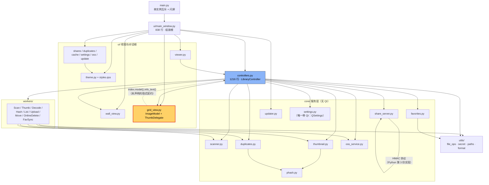

# Brooks-Lint Health Dashboard — 千寻影集 QianXun Album v1.6.4

**Mode:** Health Dashboard
**Scope:** 全项目（`src/` 34 个 Python 文件 5868 行；`server/src/` 6 个 JS 文件 1200 行；配置与文档 15 个）。基线 commit `ab9cde1`，工作区干净（仅 `docs/REVIEW_HANDOFF.md` 未跟踪，不计入审查）。无 diff，PR 维度按规则跳过并重新分配权重。
**Composite Score:** 72/100
**Date:** 2026-11-15

一句话判断：架构方向是对的（缩略图优先、全程异步、无损操作三条主线在代码里真的立住了），**安全边界与测试网是这套代码最薄的两层**；浏览器侧存在一条可被真实利用的存储型 XSS，客户端有 6 处会冻结 UI 的同步网络/磁盘调用。

| Dimension | Score | Top Finding |
|-----------|-------|------------|
| Code Quality | — | 跳过（工作区无未提交改动，无 diff 可审） |
| Architecture | 75/100 | 视图层绕过门面直取缓存实现（`thumb_path`/`QPixmapCache` 散落 6 处），任一视图无法脱离主窗体实例化 |
| Tech Debt | 65/100 | 看图页把 `oss_key` 直接拼进 400 行 HTML 模板，全服务端不存在转义函数 |
| Test Quality | 75/100 | 全仓零测试、零 CI，而 `docs/ARCHITECTURE.md:10` 声称 core 可独立单测 |

加权（PR 跳过，权重按 0.30/0.75=0.40、0.25/0.75=0.33、0.20/0.75=0.27 重新分配）：75×0.40 + 65×0.33 + 75×0.27 = **72**。

---

## Module Dependency Graph

**图上的两个问题**：① `GridView` 与 `ThumbDelegate` 之间存在一条**未声明**的反向依赖（`grid_view.py:184` 调 `index.model().info_text()`，而 `QAbstractItemModel` 并没有这个方法）；② `controllers.py`（控制层）反向 import 了 `ui/wall_view`、`ui/grid_view` 的语义（`view.page_capacity()`、`view.pager.set_state()`、`view.visible_range()`），控制层已经知道自己挂在具体视图上，抽不成独立模块。二者是「插图 1 中黄色节点」的成因，也是本层 T6（测试架构失配）的根源——视图与控制层今天无法分别实例化，因此都无法单测。

---

## Top Findings（跨维度前 5 条，按严重度）

### [P1] Cognitive Overload / Change Propagation — 看图页把对象名直接拼进 400 行 HTML
Symptom: `server/src/proxy.js:76` 的 `viewerPage()` 用模板字符串手工拼 403 行 HTML，`name` 来自 `:77` 的 `basename(rec.oss_key)`，未转义地出现在 `:102` `<title>${name} · 千寻影集</title>`、`:189` `${name}`、`:195` ``；`oss_key` 由 `index.js:98-105` 从 `POST /api/shares` 原样入库（`shares.js:24-27` 只 bind 不校验字符集）。`server/src` 内 grep `escapeHtml|htmlEscape` 零命中——整个服务端没有转义函数。
Source: Refactoring — Long Method / A Philosophy of Software Design — Information Leakage
Consequence: `oss_key` 写成 `x.png" onerror="alert(document.domain)` 即可在 `img.agentstack.vip` 原点执行任意脚本。共享密钥内嵌在分发的客户端里，任一使用者都能造出这种链接再转发——受害者在分享域名上执行攻击者脚本后可伪造任意分享页。修一条即可关闭整类风险。
Remedy: `proxy.js` 顶层加 `escapeHtml()` 并覆盖 `:102`/`:189`/`:195`（含 `alt`）与 `:191` 的 `href`；把 470 行 HTML 移到 `server/src/viewer.html`，`viewerPage()` 只做「取值 → 转义 → 替换 4 个占位符」，让新增输出点只能经过同一条转义路径。

### [P1] Dependency Disorder / 异常静默降级 — 上传前列举失败被当成「云端为空」
Symptom: `src/core/oss_service.py:223-228` `list_keys()` 在 `except Exception` 里 `return set()`；`src/controllers.py:935` 的 `create_upload_worker()` 直接 `existing = oss.list_keys()` 用它做去重基线。
Source: Refactoring — 用哨兵值掩盖非法状态；The Pragmatic Programmer — 不要静默失败
Consequence: 网络抖动 / 权限不足 / 桶名写错时，`existing` 为空集合 → 全库图片被判为「未上传」→ 整库重传（`resumable_upload` 直接覆盖同名对象）。同一文件里 `resolve_cloud_key`（`controllers.py:1001-1008`）已经刻意避免这个降级并留了注释，`list_keys` 没有跟上——同一决策两处不同答案。
Remedy: `list_keys()` 改为失败即抛；`create_upload_worker` 捕获后走 `self.status.emit(f"云端清单获取失败：{friendly_error(exc)}")` 并 **中止**上传，不退化成「空云端」。

### [P1] Cognitive Overload / 资源寿命 — 启动后 3 秒在 UI 线程同步查 Gitee Releases
Symptom: `src/ui/main_window.py:81` `QTimer.singleShot(3000, lambda: self._check_update(manual=False))`，`_check_update` 在 `:429` 直接调 `updater.check_latest()`；`src/core/updater.py:64` `urlopen(req, timeout=12)`。全程在 GUI 线程。
Source: Release It! — 阻塞调用必须隔离；A Philosophy of Software Design — 把复杂度留在边界之外
Consequence: Gitee 慢或被墙时，程序启动 3 秒后无解释地冻结最长 12 秒（窗口可拖动但无响应），用户会以为程序挂了。项目已在 `shares_dialog` / 收藏推送里建立了「网络进后台线程」的范式，这一处是漏网。
Remedy: 复用 `shares_dialog` 的 `QRunnable + Signal` 模式（提取成 `ui/async_call.py`）后台查，回调里再弹 `UpdateDialog`；顺手删掉 `main_window.py:425-427` 的空 `if not manual: pass`。

### [P1] Change Propagation — 批量保留重复图触发 N 次全量刷新
Symptom: `src/ui/duplicates_dialog.py:189-194`（`_batch`）与 `:215-218`（`_keep`）在 UI 线程调 `controller.batch_keep` / `keep_one`；`src/controllers.py:707-708`、`:728-729` 对 `rest` 逐个 `remove_item(it)`；`remove_item`（`:640-654`）每张起一个 `MoveWorker`，完成回调 `_on_moved`（`:656-662`）里逐次 `refresh_view()` + `wall_update.emit()` + `status.emit`，而 `refresh_view`（`:246-267`）每次过滤 `all_items` 全表。
Source: A Philosophy of Software Design — Change Amplification；Working Effectively with Legacy Code — 缺少批处理接缝
Consequence: 一次「每组保留最大」处理 500 张重复图 = 500 次全表过滤 + 500 次模型 reset + 500 次图片墙重绘，UI 线程连续数秒卡死；库越大越接近假死，且无法中途取消。
Remedy: 在控制器上加 `move_many(items)`，用 `_batch_pending` 计数收敛完成事件，归零时才刷新一次；`_on_moved` 拆成 `_on_moved_one`（只改内存表）与 `_on_batch_done`（刷新与提示）。

### [P1] Knowledge Duplication — 缩略图缓存协议在四个文件里各写一遍
Symptom: tier 判定三处 `src/controllers.py:427-428`、`src/ui/grid_view.py:126`、`src/ui/wall_view.py:297`；缓存键拼接 `src/ui/wall_view.py:318,321`（`f"{ck}|{tier}|{w}x{h}|c"`）与 `src/ui/grid_view.py:129,141`（`...|{tier}`、`{key}|{w}x{h}|k`），后缀 `c`/`k` 无任何文档；「取任意档位已有缓存」逻辑四份：`controllers.py:785-794`、`duplicates_dialog.py:144-159`、`wall_view.py:322-329`、`grid_view.py:131-137`。
Source: The Pragmatic Programmer — DRY / Orthogonality；A Philosophy of Software Design — Information Leakage
Consequence: 加 1024 档或调整键格式要同步改 3 个文件 6 处，漏一处不报错、只静默掉命中率（表现为「滚动变慢」）；`c`/`k` 两个后缀的语义无人能解释。这也直接挡住 T6——视图无法脱离主窗体测试。
Remedy: 在 `core/thumbnail.py` 增加 `ThumbCache` 门面：`current_tier(px)`、`pixmap(item, tier)`、`scaled(item, tier, size, mode)`，`mode` 用枚举代替 `c`/`k`；三个视图只调门面，不再出现 `QPixmapCache` 与 `thumb_path`。

---

## 全部发现

严重度按交接说明的口径：**P0** 数据丢失/崩溃/安全/死循环；**P1** 功能错误/明显卡顿/资源泄漏；**P2** 可维护性/文案/边界；**P3** 优化建议。每条都标了对应的 Brooks 风险码（R1-R6 / T1-T6）。

### P1 重要

**S1 XSS — 看图页对象名未转义即拼入 HTML**（R2/R4）
位置 `server/src/proxy.js:102,189,195`（`name` 源 `:77`；入口 `server/src/index.js:98-105`、`shares.js:24-27`）。
现象 见 Top Findings 第 1 条。
影响 `img.agentstack.vip` 原点存储型 XSS，可伪造任意分享页；`errorPage()`（`proxy.js:42-57`）今天安全纯属字面量巧合。
修复 加 `escapeHtml`，HTML 移出 JS 字符串；`errorPage` 一并走同一函数。

**S2 安全 — 图片代理透传上游 Content-Type 且无 nosniff**（R5）
位置 `server/src/proxy.js:573`（`upstream.headers.get("Content-Type") || contentTypeFor(...)`）、`:581-584`（`inline`）、`:593`。`server/src` 内 grep `nosniff|CSP` 零命中。
现象 白名单函数 `contentTypeFor()`（`:31-34`）只作兜底；上游 `text/html` 会成为响应头。
影响 客户端直连 OSS 写桶，任一使用者放入 `Content-Type: text/html` 的对象并建短链，即可在同源渲染任意 HTML，构成无需伪造签名的持久化 XSS。
修复 只用 `contentTypeFor` 且限定图片白名单，其余 `application/octet-stream` + `attachment`；补 `X-Content-Type-Options: nosniff`，`/s/*` 加 `Content-Security-Policy: default-src 'none'; img-src 'self'; style-src 'unsafe-inline'`。

**S3 数据不可自愈 — 收藏 LWW 用 `Number(x) || Date.now()` 兜底**（R6）
位置 `server/src/favorites.js:29-35`（`:31` `String(it.key)`、`:33` `Number(it.updated_at) || Date.now()`）、`:27` 的 `WHERE excluded.updated_at > favorites.updated_at`；入口 `server/src/index.js:149-151` 只校验 `Array.isArray`。
现象 缺字段 / `updated_at: 0` / `NaN` 都被替换成「当前毫秒」。
影响 客户端时钟错误或字段名写错（如 `updatedAt`）时整批以「现在」覆盖云端；升序 LWW 只接受更大时间戳，覆盖后真实时间戳永远赢不回来，只能手工改 SQL。库里还会留下 `oss_key='undefined'` 的脏行。
修复 加 `validateItem()`（`key` 非空字符串且 `Number.isFinite(updated_at) && >0`），非法条目整批 400 拒绝；根治是给表加单调 `seq`，冲突改按 `seq` 判定。

**C1 异常静默降级 — 上传前 `list_keys()` 失败当空云端**（R3/R5）
位置 `src/core/oss_service.py:223-228`、`src/controllers.py:935`。
现象/影响/修复 见 Top Findings 第 2 条。

**C2 UI 冻结 — 启动后同步查 Releases（最长 12s）**（R2）
位置 `src/ui/main_window.py:81,429`、`src/core/updater.py:59-69`。
现象/影响/修复 见 Top Findings 第 3 条。

**C3 UI 冻结 — 设置页与 OSS 配置的「测试连接」在 UI 线程发网络请求**（R2）
位置 `src/ui/settings_dialog.py:104-125`（`srv.health()` timeout=10 +`srv.list_shares()` timeout=20）、`src/ui/oss_dialogs.py:52-58`（`lib.test()` → `get_bucket_info()`，`src/core/oss_service.py:206-210` 构造 Bucket 未传 timeout）。
现象 两个 `.exec()` 模态窗在槽函数里同步做网络 I/O。
影响 地址写错或不可达时模态窗冻结 20~60 秒，Windows 标「未响应」，用户连取消都点不动；`shares_dialog.py:6-8` 的注释证明这类问题修过一次，只是没横向落地。
修复 提取 `ui/async_call.py`（QRunnable + Signal）后台执行，按钮置灰回填结果；`oss2.Bucket(..., connect_timeout=5)`；`ShareServer._request` 显式 `timeout=5`。

**C4 批量保留 N 次全量刷新**（R2）
位置 `src/ui/duplicates_dialog.py:189-194,215-218`、`src/controllers.py:640-662,707-708,728-729`。
现象/影响/修复 见 Top Findings 第 4 条。

**C5 扫描期每张图做两次 `Path.resolve()`**（R4）
位置 `src/controllers.py:205`（`it.favorite = self.favorites.contains(it.path)`，逐项）→ `src/core/favorites.py:147`（`p.resolve().relative_to(self.root.resolve())`）。
现象 每张图 = 2 次 `realpath` 系统调用；`controllers.py:282-285` 的注释已实测「`Path.resolve()` 在本机 1.92ms/次」，并为此给子文件夹筛选加了 `_folder_cache`。
影响 千张库扫描批次里固定多出约 3.8 秒纯内核开销，扫描「边出图边卡」；万张库约 38 秒。同一份性能结论在两处一个被采纳、一个被忽略。
修复 `FavoritesStore.__init__` 里缓存 `self._root_resolved`；`contains()` 改 `self._rel_cache.setdefault(str(p), ...)` 或直接用 `os.path.abspath` + 前缀比较（与 `_item_folder` 同法）。

**C6 缩略图缓存根目录每取一次路径就重算一遍**（R2/R4）
位置 `src/core/thumbnail.py:33-50`（`cache_root_for` 内 `resolve()` + `sha1`）、`:53-54`（`thumb_path` 每次调它）；调用点 `controllers.py:436-449`（每张图）、`:788-791`（`fast_pixmap` 循环两档）、`workers.py:76,162,169`。
现象 同一次操作里同一目录被 resolve 并哈希几十上百次，无任何 memo。
影响 千张库打开大图/滚动时累计数千次 `realpath`（按注释 1.92ms/次估算可达数秒），是「滚动发涩」的一个固定来源。
修复 用 `functools.lru_cache` 包一层（`str` 入参，非 Path），或让控制器在 `load_directory`/`set_online` 时算一次存进 `self.cache_root`（已经是这个字段，只是没被复用）。

**C7 查重聚类 O(n²)**（R4）
位置 `src/core/duplicates.py:16-27`（`for it, h in hashed: for c in clusters: bin(h ^ c[0]).count("1")`）。
现象 内容全不同的图库，`clusters` 长度等于图数，比较次数为 n(n−1)/2。
影响 20000 张图 = 约 2 亿次异或 + 位计数，在唯一一个 `HashWorker` 线程里跑数十秒到数分钟；期间「查重」面板一直转圈，且无法取消（只在补指纹循环里检查 `is_cancelled`，聚类循环没有）。
修复 加 4×16bit 分段索引（每段 ≤ 阈值才进入汉明计算），或先按 `phash[:4]` 分桶粗筛；聚类循环内同样检查 `is_cancelled`。

**C8 范围失真 — 「撤销全部有效」只覆盖已加载的 ≤500 条**（R2/R6）
位置 `src/ui/shares_dialog.py:148`（`srv.list_shares(limit=500)`）、`:237-263`（`_revoke_all` 的确认文案 `:244` 写「将撤销全部 {len(active)} 条」）。
现象 `limit` 硬编码 500，服务端 `listShares` 也无 total/游标；文案把「已加载」说成「全部」。
影响 记录超过 500 条时，第 501 条起在用户认为「已全部失效」后仍可公开访问，图片继续被陌生人打开，且用户无从发现。**若线上真出现过 >500 条，本条应升级 P0。**
修复 分页拉全（服务端返回 `total`/`next_cursor`），或至少在 `len(rows)` 不足时把文案改成「撤销已加载的 N 条（共 M 条）」并禁用「全部」措辞。

**C9 范围失真 — 网格可见范围求不出时回落成整库**（R2/R4）
位置 `src/ui/grid_view.py:250-261`（`first<0 → 0`、`last<0 → rowCount-1`）、`:228-231`（`resizeEvent` 立即 `geometry_changed.emit()`），下游 `src/controllers.py:421-433` 对 `range(first,last+1)` 逐个 `_submit_thumb`。
现象 视口尺寸为 0（窗口未显示就触发 resize）或 `indexAt` 落在 `setSpacing(8)` 间隙时，`first` 被强行拉回 0。
影响 每次防抖都提交 0..last 全段缩略图，万张库一次排入上万解码任务，磁盘打满、真正可见的图排在后面，表现为「滚一下就卡很久」。
修复 布局未就绪（`viewport().height() <= 0`）返回 `(0,-1)`；`indexAt` 无效时按网格尺寸算行列兜底；`ensure_visible_thumbs` 入口加「跨度 > 4×页容量则丢弃」。

**C10 配置不失效 — 改完服务端地址/密钥仍走旧客户端**（R2）
位置 `src/controllers.py:1026-1034`（`share_server()` 首次构造后缓存进 `self._share_srv`，全仓只有这一处赋值）、`src/ui/settings_dialog.py:127-140`（`accept()` 写入新 `server_base`/`server_secret`，不通知控制器）。
现象 设置保存后没有任何失效路径；`_share_srv` 生命周期 = 主窗体生命周期。
影响 用户改密钥 → 「测试连接」显示成功（那是新建的临时 `ShareServer`）→ 回到主界面分享仍用旧密钥 → 全部 401，只能重启程序；改地址则静默分享到旧服务器。配置改了但行为没变，是最难自证的一类 bug。
修复 给 `AppSettings` 加变更信号或让 `SettingsDialog.accept()` 显式 `controller.reset_share_server()`（置 `None` + `_cloud_keys = None`）。

### P2 一般

**S4 签名域不含 query、nonce 读了不用，注释却声称防重放**（R3）
位置 `server/src/auth.js:82-89`（canonical 只有 METHOD/PATH/TS/NONCE/BODYHASH）、`:58` 读出 `nonce` 后无任何存储比对、`:7`/`:13` 注释写「配合时间窗降低重放面」「防重放」。
影响 300 秒内抓到任意一条已签名请求即可原样重放；且同一签名对任意 query 有效——「看到过一次 `GET /api/shares`」等于「5 分钟内可任意定向查所有分享」。
修复 canonical 加第 6 行「排序后的 query」（客户端 `src/core/share_server.py:72-83` 已把 query 拆出来了，改成一起签）；`nonce` 落 D1 `nonce_seen` 并 `ON CONFLICT DO NOTHING`；短期至少把 `AUTH_WINDOW` 压到 30 并修正注释。

**S5 配置 fail-open — `AUTH_WINDOW` 非数字时时间窗静默消失**（R1）
位置 `server/src/auth.js:69-73`（`Number(env.AUTH_WINDOW || 300)`；`skew > NaN` 恒 false）。
影响 写成 `"300s"`/`"5m"` 后任何时间戳的签名永久有效，`/health`（`index.js:74-80`）不报该变量，部署后完全看不出来。
修复 显式校验：`if (!Number.isFinite(raw) || raw <= 0) return {ok:false,status:500,error:"bad_auth_window"}`；`/health` 输出该变量的有效/无效状态。

**S6 生命周期未建模 — 短链永不过期，且每次看图同步写一行 D1**（R6/R4）
位置 `server/schema.sql:4-15`（无 `expires_at`）、`server/src/shares.js:84-90`（`resolveShare` 只看 revoked）、`server/src/proxy.js:541,569`（`await recordHit`）、`shares.js:96-110`（每次 `UPDATE shares SET hits=hits+1`）。
影响 token 一旦外泄即永久有效，删对象/换账号都不能让它失效；`/s/*` 是公开端点且无限流，链接被转发后每次访客 = 1 次 D1 写，Free 计划日写配额打满会连带把 `createShare`/`revokeShare`/收藏同步一起打挂，表现是「分享和收藏突然全报错」。
修复 schema 加 `expires_at`（默认 30 天），`resolveShare` 加 `AND (expires_at IS NULL OR expires_at > ?)`，过期与撤销同文案 410；`recordHit` 改 `ctx.waitUntil()` 并采样；`/s/*` 与 `/health` 加粗限流，`/health` 的 DB 探测缓存 30s。

**S7 静默丢尾 — 收藏拉取 `LIMIT 5000` 无游标**（R2）
位置 `server/src/favorites.js:51`、返回体 `server/src/index.js:155-159`（只有 `{count, items}`）；客户端 `src/workers/workers.py:316` 以不带 `since` 的方式每次全量拉。
影响 超过 5000 条后第 5001 条起永远拉不到，客户端认为同步完成，用户只看到「另一台机器收藏对不上」而无任何错误。
修复 改游标分页返回 `next_cursor`；推送侧 `slice(0, MAX)` 改为超限报 413，绝不静默丢弃。

**S8 零测试 + 产物入库**（T5/T6）
位置 `server/package.json` 只有 `devDependencies.wrangler`（无 name/scripts/test）；全仓无测试目录、无 CI；`server/dist/index.js`、`index.js.map`、`upload.js` 在版本库里，而 `wrangler.toml:8` 的 `main = "src/index.js"` 指向源码。
影响 本次审查里所有签名/时间窗/body hash 结论只能靠人工读代码；`src/core/share_server.py:32-37` 的注释记录了「漏算空 body hash 导致全部 DELETE 401」——那次事故正是这个缺口的代价。`dist/upload.js` 这个不存在的源文件还会让人误判系统曾有上传网关。
修复 补 `scripts.test` + `vitest` + `@cloudflare/vitest-pool-workers`，至少覆盖 `verifyRequest`（含空 body DELETE、±1s 窗口、非法 AUTH_WINDOW、query 篡改）、`presignGetUrl`（固定时间断言签名 hex）、`makeToken`；`dist/` 从版本库移除并加 `.gitignore`。

**S9 概念重复 — 加密原语/token 解析/死代码三处**（R3/R4）
位置 `sha256Hex` 在 `auth.js:20-23` 与 `oss.js:26-29` 各一份，hex 转换在 `auth.js:22,34`、`oss.js:28,43` 共四份；token 后缀解析 `index.js:53-57` 与 `proxy.js:513-516` 各一套且规则不等价；死代码 `proxy.js:93-94` `jsName`/`jsUrl`（从未使用，却在为 S1 的 XSS 提供「已安全注入」的假象）、`auth.js:99-104` `signForClient`（无调用点，是 canonical 的第 2 份实现）。
影响 签名路径「改一处必须改两处」，漏改的表现不是报错而是「某条路径签名永远对不上」；token 解析两套事实来源会在边缘输入上让「看图页 vs 图片代理」给出错误响应。
修复 新建 `server/src/crypto.js` 导出 `sha256Hex/hmacHex/hex` 供两处 import；抽 `parseShortPath(pathname) -> {token, ext}`；删掉三个死代码，并把 `signForClient` 改写成固定向量的测试用例。

**S10 长函数 — `index.js` 120 行 fetch + 三段重复的 bad_json；`proxy.js` 403 行 HTML 函数**（R1/R3）
位置 `server/src/index.js:43-162`（8 条路由平铺，`:93-97`/`:130-134`/`:144-148` 三段字面量完全一致）、`server/src/proxy.js:76-479`（`:96-186` CSS、`:197-468` 内联 JS）。
影响 新增一条路由要同步改 3 处形态，漏一处就落到 `:161` 的 404 兜底；403 行模板无法语法高亮、无法调试（内联脚本报错行号指向 HTML），第 4 次改样式就会引入 S1 那类拼接 bug。
修复 抽 `readJson(request)` 与表驱动 `ROUTES`；HTML 移进 `viewer.html`（模板占位符替换）。

**F1 缓存协议四处重复**（R3）— 见 Top Findings 第 5 条，位置 `controllers.py:427-428,785-794`、`grid_view.py:126,129,131-137,141`、`wall_view.py:297,318,321,322-329`、`duplicates_dialog.py:144-159`。

**F2 防抖策略不对称 — 网格 resize 无防抖，图片墙有**（R2/R3）
位置 `src/ui/grid_view.py:228-231`（`resizeEvent` 里 `_debounce.start()` **并立刻** `geometry_changed.emit()`）→ `src/controllers.py:421-424` → `_apply_to_model()`（`:355-372`）；对照 `src/ui/wall_view.py:59-62,133-136` 用 60ms `_relayout_timer`。
影响 拖窗口边缘时每个像素重算页容量与页码夹取，分页模式下列表跳动、单核打满；两个视图缩放手感不一致。
修复 `geometry_changed` 只在防抖 timeout 里发一次；`on_view_resized` 内对 `_apply_to_model` 也加 50ms 合并。

**F3 交互路径残留 O(n) — `_vertical_neighbor` 全库线性扫描**（R4）
位置 `src/ui/wall_view.py:259-276`（`for i, cell in enumerate(self._cells)` 遍历全部格子），由 `:249` 在上下键调用。
影响 2 万张图时每次方向键 2 万次矩形中心计算，按住方向键明显掉帧；`index_at`、`paintEvent` 都已用二分索引优化，只有这条路径没跟上。
修复 用 `bisect_right(self._row_tops, cur.y())-1` 定位当前行，只在 `k-1`/`k+1` 两行的下标区间里找最近者。

**F4 绘制状态泄漏 — 图片墙字体设置不还原**（R1）
位置 `src/ui/wall_view.py:342-349`（星标 `setBold(True)` + `setPixelSize(15)` 后从不恢复），`:310-313` 的「已损坏」文字依赖当前字体；对照 `src/ui/grid_view.py:157-178` 两个角标都做了 `save()/restore()`。
影响 有星标的格后面如果是损坏图，「已损坏」会以 15px 粗体居中绘制，与相邻格 13px 常规字混排；换主题时这类串味会扩散。
修复 每个细节块（损坏/星标/重复标/焦点框/选中框）统一 `p.save()/p.restore()` 包裹，字体只改局部变量。

**F5 资源不释放 — 大图覆盖层全分辨率 QPixmap 关闭后不释放**（R4）
位置 `src/ui/viewer.py:22` 初始化、`:77,123` 换图、`:215` Esc 只 `self.hide()`；全文件无 `hideEvent`，也没有 `self._pix = QPixmap()` 的释放路径。
影响 看过一张 6000×4000 的图后关闭查看器，进程常驻多占约 96MB；长时间浏览后内存曲线阶梯上升。
修复 `hideEvent` 里 `self._pix = QPixmap()`；`show_index` 给上一张的 `DecodeWorker` 打取消标记（`request_decode` 增加 `cancel_key`，`_on_decoded` 按 token 丢弃）。

**F6 死分支 — 小图双击缩放是空操作**（R1/R4）
位置 `src/ui/viewer.py:195-209`：`fit = self._fit_scale()` 对 40×40 图约 23；进入分支时 `_scale` 已由 `:81` 设为 `min(fit,1.0)=1.0`，`if abs(self._scale-fit) > 1e-6` 成立 → `_scale = max(MIN, min(fit, MAX, 1.0)) = 1.0`，前后无变化。
影响 小图双击后画面完全不动，用户判断为双击失灵；大图双击正常，形成不一致的隐性契约。
修复 用单一目标缩放函数建模：`target = 1.0 if self._scale < 1.0 else min(fit, 1.0)`，仅当 `target != _scale` 才应用；或对小图明确禁用并给 tooltip。

**F7 重复处理 — `_keep` 后界面不置灰，可与 `_batch` 二次操作同一组**（R2/R3）
位置 `src/ui/duplicates_dialog.py:196-219`（`finally` 里立刻复位 `_busy`，随后既无 `self.accept()` 也无按钮置灰；对照 `_batch` 在 `:194` 调了 `accept()`）；两函数除遍历范围几乎逐行相同。
影响 用户在「第 3 组」点保留最大 → 界面毫无变化 → 再点一次或接着点「一键保留最大」→ 对已在 `Remove/` 的文件再移出，产生重复记录/改名，甚至把已移出项算进 `active` 导致「保留最新」选错对象。
修复 抽 `_collect_active(gi)` 与 `_confirm_if_online(n, by, scope)`；成功后把该组替换成「已处理：保留 X，移出 N 张（撤销）」并禁用按钮。

**F8 死状态与不一致交互 — `_total_h` 只写不读；右键点空白不清选择**（R1）
位置 `src/ui/wall_view.py:42,114`（`_total_h` 无读取）、`:190-198` vs `:219-225`（左键空白清空选择，右键空白什么都不做）。
影响 调试时多一条干扰线索；右键空白后旧选择仍在，随后的 Del/F 作用在看不见的选择上，有误删的心理负担。
修复 删掉 `_total_h` 或真正用于 `setRange`；右键分支补齐 `else: 清空选择`，两处合并成 `_clear_selection()`。

**F9 状态藏在控件文本里 — 缓存对话框字符串拼接提示**（R1）
位置 `src/ui/cache_dialog.py:52-53,66-67,82-83`（`self.label.setText(self.label.text() + "...")`）。
影响 连点两次「清理孤儿缓存」提示叠加成两行重复文案；将来做日志/复制时取不到干净数值。
修复 `_refresh(extra="")` 统一 `setText`，三处改为 `self._refresh(extra=...)`。

**F10 契约脆弱 — 以 `None` 调 Qt 虚函数 `sizeHint(None, None)`**（R1/R5）
位置 `src/ui/grid_view.py:267`、`src/controllers.py:415`；`ThumbDelegate.sizeHint` 目前不读 `option`/`index` 才侥幸可用。
影响 一旦有人给它加 `if option.state & ...`（很自然的下一步），打开分页视图就 `AttributeError: 'NoneType'`——把实现细节冻成了隐含契约。
修复 给 delegate 加纯计算 `card_size() -> QSize`，`sizeHint` 只 `return self.card_size()`，调用方统一用 `card_size()`。

**F11 隐式契约 — Delegate 直接下探具体模型方法**（R5）
位置 `src/ui/grid_view.py:184` `index.model().info_text(item)`，`QAbstractItemModel` 无此方法，只有 `ImageModel`（`:56-61`）有。
影响 插入 `QSortFilterProxyModel`（做排序/过滤是自然下一步）后 `index.model()` 变成代理，绘制时抛 `AttributeError`，且异常发生在 `paint()` 里，只留下半绘制卡片，崩溃点离改动点很远。
修复 改成模型角色 `ROLE_INFO = UserRole + 2`，`data()` 里按 `info_mode` 返回字符串，delegate 只 `index.data(ROLE_INFO)`。

**F12 撤销计数丢失 — 单条 `revoke` 无 try，异常吞掉已完成数**（R2）
位置 `src/ui/shares_dialog.py:226-232`（`work()` 里 `ok, _ = srv.revoke(t)` 无 try）、`:41-47`、`:119-129`（`_finish` 里 `self._workers.clear()` 整体清空）。
影响 任一条抛异常就跳进 except，用户只看到「操作失败: TimeoutError」，不知道实际撤销 7 条 / 未撤 3 条；改用「撤销全部」重试时对已撤销项再 revoke 会得 410，摘要出现「N 条失败」的假失败。
修复 `work()` 内逐条 try 并返回 `(done, failed, first_error)`；`_run` 把 worker 传给 `_finish` 只 `remove` 对应项。

**F13 重复试错 — 每张重复图挂一个 `QGraphicsOpacityEffect`**（R4）
位置 `src/ui/duplicates_dialog.py:77-78`（`setGraphicsEffect`），仅在勾选「排除」时改透明度 `:87-88`。
影响 `QGraphicsOpacityEffect` 让 QLabel 走离屏合成，几十组 × 每组数张时首次打开明显延迟、滚动发涩。
修复 勾选时换预生成的灰蒙版 pixmap，或 `setEnabled(False)` + qss 的 `:disabled` 样式。

**F14 静默失败 — 「打开发布页」失败被吞，正文链接不可点**（R2）
位置 `src/ui/update_dialog.py:70-75`（`except Exception: pass` 后无条件 `accept()`）、`:37-41`（`setOpenExternalLinks(True)` 却用 `setPlainText`）。
影响 无默认浏览器或被安全软件拦截时，用户点「打开发布页」→ 对话框关闭 → 什么都没发生且无法重试。
修复 `except` 保留对话框、按钮改「打开失败，点此复制链接」；正文改 `setHtml()` 并把裸 URL 包进 `<a>`，让 `setOpenExternalLinks` 真正生效。

**F15 主题色两套来源 + 9 处内联硬编码**（R3/R1）
位置 `src/ui/theme.py:4-8` 自述「换主题要改两处」而 `src/ui/styles.qss:1-5` 仍字面量重复；内联硬编码在 `shares_dialog.py:70`、`duplicates_dialog.py:31,51,54,68,86,116`、`settings_dialog.py:67`、`update_dialog.py:34`、`main_window.py:59`。
影响 加浅色模式要改三处（theme + qss + 9 处内联），漏一处就是「一个灰字跟别的灰字不一样」；内联 `setStyleSheet` 还会覆盖 qss 继承，统一调整对该控件无效。
修复 `theme.py` 提供 `muted(label)` 之类小工厂；`styles.qss` 改成模板在启动时用 `theme` 常量渲染。

**F16 一次性补丁堆积 — `QWidget` 全局底色 + 逐点透明补丁**（R2/R4）
位置 `src/ui/styles.qss:7-12`（所有 `QWidget` 设 `#202124`）、`:93`（补 `QLabel{background:transparent}`）、`src/ui/main_window.py:59`（再补一次）。
影响 新增复合控件都继承不透明底色，出现「深色方块压在图片上」，每加一个控件就再补一条规则，qss 只增不减。
修复 默认背景收窄到 `QMainWindow, QDialog, QListView, QScrollArea` 等容器，删掉两处补丁。

**F17 魔法数 — 滚轮量纲两份实现、换算系数还不一致**（R3/R1）
位置 `src/ui/wall_view.py:21-29`（`pixelDelta * 3`，注释「约 3 倍折算」）、`:186-188`（`max(120, row_height)`、`int(dy/120*step)`）；`src/ui/viewer.py:161-166` 内联另一份且不乘系数。
影响 同一触控板在图片墙与大图页手感差 3 倍；`int()` 向零截断让小增量变成固定步，微调滚不动或滚过头。
修复 抽 `ui/input.py` 的 `wheel_steps(event) -> float`（统一除以 120），两处只调它；常量命名 `WHEEL_UNIT`/`TIER_PX`/`ASPECT_MIN`/`ASPECT_MAX`。

**F18 组件不自持状态 — `PagerBar` 不自更新页码、不夹取载荷**（R1/R2）
位置 `src/ui/pager.py:29-32`（四个 lambda 直接 `emit(self._page ± 1)` / `emit(self._total - 1)`），`self._page` 只在 `set_state`（`:34-41`）更新。
影响 快速双击「下一页」会发出两次相同目标页码（重复请求）而不跳页；调用方忘记夹取时可能出现 `-1`/`total` 进入控制器。当前靠按钮 `setEnabled` 兜住，属隐式契约。
修复 emit 前先 `self.set_state(target, self._total)` 只发夹取后的值；或改信号为 `page_delta(int)`，页状态由控制器独占。

**F19 语义借货 — `BG_CORRUPTED` 被当成卡片按钮底色；`FOCUS`/`HUD_BG` 是空扩展点**（R3/R4）
位置 `src/ui/theme.py:18-19`（`BG_CORRUPTED` 与 `BORDER` 同值）、`src/ui/grid_view.py:190`（用 `BG_CORRUPTED` 画按钮底色）；`theme.py:27-28` `ACCENT`/`FOCUS` 同值且 `FOCUS` 无引用、`:33` `HUD_BG` 无引用而 `viewer.py:151-152` 直接写 `QColor(0,0,0,130)`。
影响 改「损坏图」配色会连带改掉五个按钮底色；改 `FOCUS` 什么都不会发生——看似存在的扩展点是空的。
修复 新增 `BG_BUTTON`/`BG_BUTTON_HOVER`；删除或真正启用 `FOCUS`/`HUD_BG`。

**D1 文档与实现漂移**（R3）
位置 `docs/ARCHITECTURE.md:75`（写 favorites v1 `{"version":1,...}`，实现是 v2 带 `updated_at`，见 `src/core/favorites.py:6-16`）、`:85`（QSettings 键只列 9 个，实际另有 `oss_*`/`server_*`/`share_days`/`scan_parallel`/`upload_*`/`skipped_version`/`check_updates` 共 13 个）、`:34`（utils 层漏写 `secret.py`）、`:97`（称缓存写失败会「状态栏提示」，实际 `thumbnail.generate` 失败只让 `_on_thumb_failed` 累计计数，无提示）、`:10`（称 core 可独立单测，实际零测试且视图与控制器互相穿透）。
影响 接手者按文档理解系统会得出错误结论——尤其 `:10` 与 `:34` 这两条会让人以为「已经有可测边界」和「密钥处理不在这一层」。
修复 按实现逐条更新文档；建议在 CI 里加一条「`meta.VERSION` == CHANGELOG 顶部 == README 徽标」的断言（当前四处一致，但没有机制保证）。

**D2 死代码与重复常量**（R3/R4）
位置 `IMAGE_EXTS` 在 `src/core/scanner.py:21` 与 `src/core/oss_service.py:15` 各一份（新增格式只改一处会让文件「本地上传得了、在线库看不到」）；`src/core/phash.py:58` `hamming()` 无调用（`duplicates.py:22` 自己写了一遍 `bin(x^y).count("1")`）；`src/core/thumbnail.py:57` `has_cache()` 无调用；`src/core/oss_service.py:277` `is_public()` 无调用；`src/controllers.py:23` import 了 `SHARE_EXPIRES` 但从不使用（`share_link` 直接用 `settings.share_days`）；`src/core/oss_service.py:16` 的 `PREFIX = "qx/"` 与 `controllers.py:1117` 的 `key[len("qx/"):]` 靠字符串字面量耦合（改前缀会静默传出错误 key）。
影响 同一决策两处表达，漂移时不报错；`key[len("qx/"):]` 是典型的「设计决定泄漏到调用方」。
修复 统一 `IMAGE_EXTS` 到 `core/` 一个模块；删掉四个死函数与死 import；`UploadWorker` 改收「绝对 key」而非「相对 rel」，删掉那处切片。

**D3 依赖不可重现**（R5）
位置 `requirements.txt` 只有 `>= PySide6>=6.7 / Pillow>=10 / numpy>=1.24 / oss2>=2.18.4 / pyinstaller>=6`，无上限、无 lock、无 hash；`server/package.json` 只有 `wrangler ^4.152.0` 且无 `name`/`private`。
影响 同一 commit 在不同时间打包会得到不同依赖树，`docs/ARCHITECTURE.md` 里记录的实测数字（0.47s→0.05s 等）无法复现；PySide6 次版本升级带来的绘制/事件差异会以「上次还好好的」形式出现。
修复 生成 `requirements.lock`（`pip freeze` 或 `uv lock`）并把运行依赖钉到次版本；`package.json` 补 `name`/`private`/`scripts`，把 `wrangler` 换成 `~` 精确到次版本。

### P3 建议

- **R3** `src/core/settings.py` 239 行里有 20 组几乎逐字相同的 `getter/setter`，键名在两侧各写一遍（改键名要改两处，漏改读的是旧键、写的是新键，静默不一致）。可用描述符或 `__getattr__` 表驱动收口。
- **R1** `src/ui/settings_dialog.py:13` `__init__` 75 行、`src/ui/duplicates_dialog.py:20` `__init__` 119 行、`src/ui/grid_view.py:101` `paint` 99 行——都是「一串控件/绘制分支」的线性堆叠，虽可读但每次加一个控件都在加长同一个函数；建议按「分组构建」拆成 `_build_dirs()`/`_build_oss()` 等小方法。
- **R4** `src/core/thumbnail.py:25` 模块级设置 `Image.MAX_IMAGE_PIXELS = 200_000_000`，把 Pillow 的解压炸弹保护从默认约 8900 万像素放宽到 2 亿；本地看图场景问题不大，但建议用局部 `Image.open` + 显式尺寸校验表达同一意图，不去改库的全局防御阈值。
- **R1** `src/ui/viewer.py` 的 `_fit_scale`/`_zoom_at` 与 `wall_view` 的宽高比夹取都用裸浮点常量（`0.2/5.0`、`MIN_SCALE`/`MAX_SCALE`），建议集中到一处并注明单位。
- **R2** `src/core/oss_service.py` 的 `friendly_error()`（`:107-130`）用正则从字符串里捞 `Code`/`Message`，属「靠错误文案解析」的脆弱耦合；oss2 有类型化异常（`details` 分支已处理），建议以类型分支为主、正则作兜底，并在注释里标明何时可删。
- **R6** `ImageItem`（`src/core/image_item.py`）是纯数据袋且挂着 UI 用的 `_folder_cache`，缓存职责落在实体上；建议把该缓存移到控制器的 `dict[str, str]`，让实体保持无副作用。
- **R5** `server/wrangler.toml:22` 把 D1 `database_id` 明文入库。它不是凭据（无法单独用于访问），但属于基础设施标识；若仓库长期公开，建议改成 `wrangler secret`/`--var` 注入，减少可枚举面。

---

## Summary

最该先做的一件事：**把 `server/src/proxy.js` 的输出面转义收口**（S1 + S2）。这两条是本次唯一「可被真实利用」级别的问题，而修法很小——一个 `escapeHtml` + `contentTypeFor` 白名单 + `nosniff`，半天工作量，能关掉整类 XSS。

其次按投入产出排：**给三个纯边界补最小测试集**（`verifyRequest` / `presignGetUrl` / `makeToken`）——服务端现在完全靠客户端联调当回归测试，而 `share_server.py:32-37` 的注释已经证明这条路付过一次代价（全部 DELETE 401）。有了这组用例，S4 那种协议改动才可执行而不是靠记忆。

趋势上，这个项目的腐化形态很清晰：**每一类问题的解法都被正确地找到过一次，但没有横向落地**——网络后台化只发生在 `shares_dialog`，防抖只发生在 `wall_view`，`resolve()` 的代价只被 `_item_folder` 采纳，`list_keys` 的降级只被 `resolve_cloud_key` 避开。因此下一个版本的最高杠杆动作不是修更多 bug，而是把这三件已证明有效的东西（后台执行器、防抖工具、缓存门面）各抽成一个共享件——它同时消掉本报告里 R2/R3 的大半条目，并把 T6 从「不可能单测」变成「可以单测」。

建议下一轮单独跑 `brooks-test`：测试维度是这次唯一「没有任何输入」的维度（75 分来自「零测试」这一条客观事实，而非对既有测试的质量判断），它的实际状况需要先建立测试才有得评。
