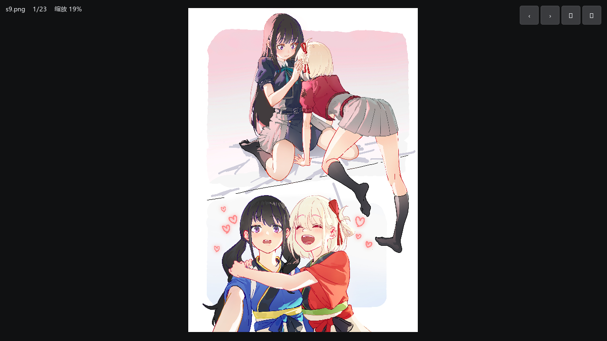
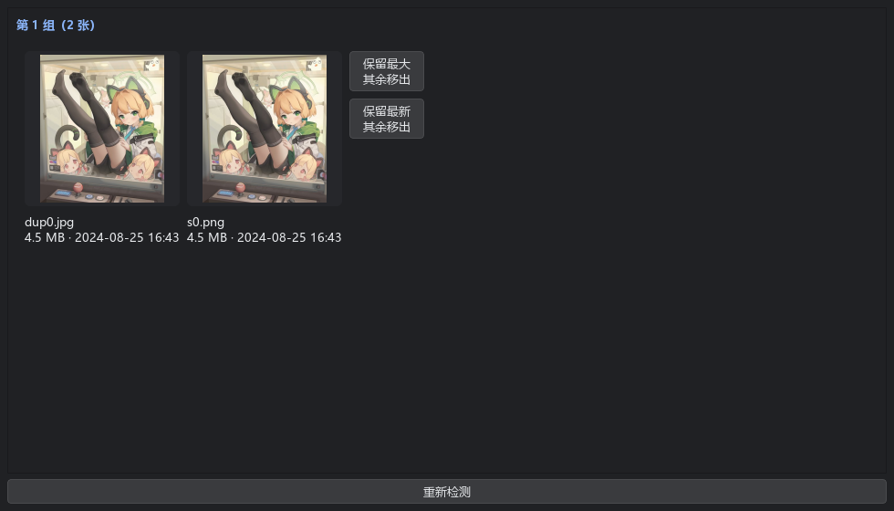
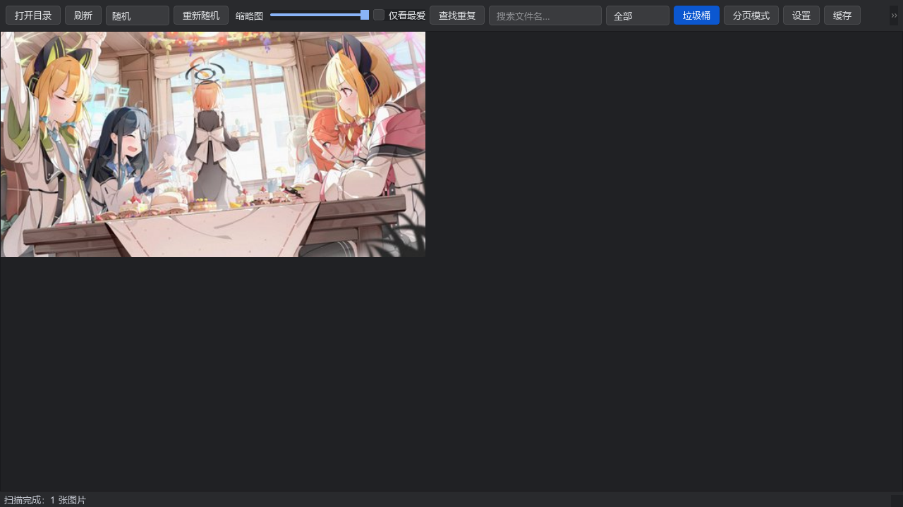
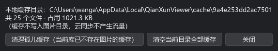
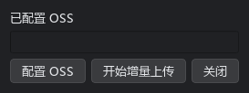
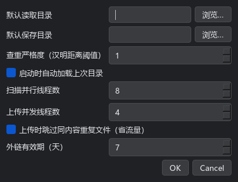

# 用户指南

千寻影集 v1.5.4 · 版权所有 © 羡林i (Y_XianLin)

## 0. 界面速览

启动闪屏 → 主窗体：

图片墙（默认）与多选：

分页模式（卡片按钮行）：

大图浏览器：

重复面板 / 垃圾桶 / 缓存 / 上传 / 设置 / 在线库：

## 1. 启动与加载图片

- **打开目录**：工具栏「打开目录」按钮，选择任意文件夹后递归扫描（自动跳过 `Remove/` 与隐藏缓存目录）。
- **拖拽加载**：直接把文件夹从资源管理器拖进窗口即可加载。
- **默认目录**：「设置」中配置"默认读取目录"后，每次启动自动加载，无需再选。
- **状态记忆**：未设置默认目录时，启动自动恢复上次浏览的目录、展示模式、缩略图大小、页码/滚动位置与窗口几何。
- 扫描为增量呈现：列表边扫边出，标题栏实时更新 `千寻影集 — N 张 · 共 X GB`。
- **工具栏总览**：工具栏只保留高频项——打开目录 / 排序 / 重新随机 / 缩略图滑块 / 搜索 / 分页模式 / 在线库；低频项（刷新、查找重复、仅看最爱、长宽比、垃圾桶、上传到云、缓存管理、设置、关于）收进「更多 ▾」菜单；「文件夹」下拉仅在存在子文件夹时出现；菜单内有生效中的筛选/状态时，「更多」显示为「更多 ●」。

## 2. 展示模式

### 2.1 图片墙（滚动模式，默认）

- 不显示文件名，图片以 justified 布局**无缝拼接**：每行按图片宽高比自动决定张数并铺满整行，行高接近滑块目标值。
- 滚轮/滚动条上下浏览（已加速：每格滚轮至少一行高度）；缩略图按视口优先生成，未生成时显示占位色块，生成后逐张替换。
- 单击图片直接进入大图浏览器；右键弹出操作菜单。
- **多选**：`Ctrl+点击` 切换选中、`Shift+点击` 范围选、右键预选（金色选框）；选中后 `F`/`Del`/`Ctrl+C`/`Ctrl+S` 与右键菜单均批量生效；点空白清除选择。
- **键盘导航**：点击墙获得焦点后，方向键移动蓝色焦点框，`Enter` 进入大图。

### 2.2 分页模式

- 工具栏「分页模式」切换；底部页码条支持 首页/上一页/下一页/末页，每页张数随窗体尺寸自动重算。
- 每张卡片显示：缩略图 + 信息行（随排序方式变化：文件名 / 时间 / `大小 · 分辨率`）+ **基础功能按钮行**：
  - `★` 切换最爱（已收藏呈金色）
  - `存` 另存为
  - `拷` 复制图片到剪贴板
  - `位` 打开所在位置
  - `移` 移出到垃圾桶（垃圾桶内变为「还原」）
- 再次点击已选中的卡片也可进入大图。

### 2.3 缩略图滑块

工具栏滑块实时调整图片墙行高 / 分页卡片尺寸；超过 256 时自动改用 512 档缓存。

## 3. 搜索、长宽比、文件夹与排序

- **文件名搜索**：工具栏搜索框输入即实时过滤（子串、不区分大小写），可与排序、「仅看最爱」（更多菜单）叠加；点 ✕ 或清空恢复。
- **长宽比筛选**：「更多」→「长宽比筛选」子菜单，选项模式——预设为互斥勾选项（`1:1 / 4:3 / 3:2 / 16:9 / 2:1 / 3:4 / 2:3 / 9:16 / 1:2`），选「全部」清除；「自定义…」可输入任意比例（如 `1.5:3`）或单个浮点（宽÷高），确认后成为新的勾选项。判定为“整体符合”：容差 ±10%，例如 210×200 会归入 1:1。损坏图（读不到分辨率）在筛选时不显示。
- **文件夹筛选**：「文件夹」下拉列出所有子文件夹（含祖先层级），选中后仅显示该目录及其子树；本地 / 在线库 / 垃圾桶通用，与搜索、长宽比、排序、仅看最爱任意叠加。

工具栏下拉：随机（默认）/ 时间正序 / 时间倒序 / 大小正序 / 大小倒序。
随机排序同目录结果稳定；「重新随机」按钮更换种子。排序只重排列表，不重新生成缩略图。

## 4. 最爱

- 选中图片按 `F`，或右键「切换最爱」，或分页卡片 `★` 按钮。
- 缩略图左上角显示金色星标；「仅看最爱」过滤视图，展示逻辑与主视图一致。
- 配置存于图片目录下 `favorites.json`（只记相对路径），整个文件夹移动后依然生效。

## 5. 大图浏览器

- 进入：图片墙单击 / 分页卡片再次点击。
- 缩放：滚轮 1%~800%，锚定鼠标位置；**双击**在"适应窗口"与 100% 之间切换。
- 平移：按住左键拖拽。
- 旋转：⟳ 按钮或 `R` 键，90° 步进（视图级，不修改文件）。
- 切换：`←` / `→`（后台预加载前后各 1 张）、右上角 ‹ › 按钮；`Esc` 或 ✕ 按钮返回。
- 收藏：大图内按 `F` 直接切换最爱（HUD 显示 ★）。
- 加载策略：先显示 512 档缓存图，原图后台解码完成后无缝替换；超大图自动降采样防内存爆炸。

## 6. 图片操作

| 操作 | 入口 | 快捷键 |
|---|---|---|
| 另存为 | 右键 / 卡片「存」 | `Ctrl+S` |
| 复制图片 | 右键 / 卡片「拷」 | `Ctrl+C` |
| 复制文件 | 右键（粘贴到资源管理器） | — |
| 打开所在位置 | 右键 / 卡片「位」 | `Ctrl+O` |
| 移出图片 | 右键 / 卡片「移」 | `Del` |

- 另存为：设置了"默认保存目录"时直接保存（重名自动加后缀）；未设置时弹出目录选择框。
- 复制图片：以 512 档缩略图写入剪贴板，可直接粘贴到聊天软件。

## 7. 垃圾桶（无损操作）

- 程序**不做任何删除**：「移出」= 移动到图片根目录下 `Remove/`，重名自动加后缀，操作可逆。
- 「更多」菜单「垃圾桶」进入垃圾桶页面：标题显示 `垃圾桶 — N 张`；支持图片墙/分页两种展示。
- 还原：选中后按 `R`、右键「还原」或卡片「还原」按钮，文件回到**原来的子目录**（原目录被删时回到根目录）。
- 退出垃圾桶：再次勾选「更多」→「垃圾桶」，回到主视图并重新扫描。

## 8. 重复图片检测

- 全部缩略图生成完毕后后台自动比对 pHash，汉明距离 ≤ 阈值（默认 4）判为疑似重复，右上角蓝色「重」角标。
- 「更多」→「查找重复」打开重复组面板：每组并排预览（文件名/大小/时间）；每张图带「排除（非重复）」勾选（勾选后预览变淡），每组标题带「排除该组」勾选；底部「一键保留最大/最新（处理未排除组）」跨组批量处理——每个未排除组保留一张，其余统一移出（本地可逆）；单组也可用组内「保留最大/最新」按钮单独处理。
- 若仍有个别「不像的」被判重复，或真重复没检出：「设置」→「查重严格度」调小/调大阈值后重新「查找重复」。
- 在线库同样支持查重：缺指纹的云端图片会先下载 IMG 缩略图补算 pHash（状态栏显示进度）；批量/单组处理在在线模式会弹不可逆确认框（显示组数与删除张数），确认后直接删除云端重复对象（同步清理增量上传索引）。

## 9. 设置、缓存与关于

- 「设置」：默认读取目录、默认保存目录（浏览按钮选择）。
- 「更多」→「缓存管理」：查看本地缓存占用；「清理孤儿缓存」删除已不存在图片的缓存；「清空全部缓存」后浏览时自动重建。
- 「更多」→「刷新」/`F5`：重新扫描当前目录；目录发生增删时程序也会防抖自动刷新。
- 单实例保护：重复双击 exe 不会开新窗，而是激活已有窗口。
- 「更多」→「关于」：版本与版权信息（羡林i / Y_XianLin）。
- `F11` 全屏；窗口比例远离 2:1 时状态栏给出一次提示。

## 10. 在线库（阿里云 OSS）

- **配置**：「更多」→「上传到云」→「配置 OSS」，填 Endpoint、Bucket、AccessKey ID/Secret；「测试连接」验证后保存。配置仅存本机用户目录（`%APPDATA%\QianXun\QianXunViewer.ini`），其中 **Secret 用 Windows DPAPI 加密**（绑定当前 Windows 账户，不会明文落盘、不上传不外传）。
  - Endpoint 默认用直连域名（如 `https://oss-cn-qingdao.aliyuncs.com`，同地域快且流量便宜）；
  - 跨地域/远距离访问慢时，可改为传输加速域名 `https://oss-accelerate.aliyuncs.com`（加速流量费更高）。
  - **新建 Bucket**：阿里云自 2025-09-01 起新建的桶不支持 V1 签名，程序会按 Endpoint 自动推导地域并使用 V4 签名（旧桶 V1/V4 都可用）；因此 Endpoint 建议填地域域名，自定义域名/加速域名推导不出地域，会退回 V1，可能无法访问新桶。
  - **RAM 权限**：AccessKey 需具备桶级「列表对象 / 桶信息」与对象级「读 / 写 / 删 / 对象 ACL」权限。权限不足的典型报错：「测试连接」或在线库报 `The bucket you access does not belong to you.`（缺 ListObjects/GetBucketInfo），在线删重报 `no right to access this object because of bucket acl`（缺 DeleteObject）。最小权限清单见 [ONLINE_DESIGN.md §5](ONLINE_DESIGN.md)，省事也可直接给该 RAM 用户挂系统策略 `AliyunOSSFullAccess`。
- **换桶**：直接改配置为新 Endpoint/Bucket/AK 即可——上传索引按桶分文件存放，不会把新桶误认为「已上传过」；本地图库重新「上传到云」即可重传。
- **设置面板**：默认读取/保存目录、查重阈值、上传并发线程（1–8）、扫描并行（1–16）、外链有效期（1–7 天）、同内容跳过开关、启动自动加载上次目录。
- **上传**：「更多」→「上传到云」→「开始增量上传」：三层跳过——本地索引已传、云端已存在（一次列举）、批内同内容（size+pHash，设置可关）；多线程并发上传，进度条实时显示，结束显示 新传/跳过/失败。
- **在线浏览**：工具栏「在线库」开关；列表/缩略图/大图全走签名 URL，缩略图由 OSS IMG 实时缩放（`resize+format`），不落云盘缓存。
- **在线查重**：「查找重复」对云端图片同样有效——自动补算缺失的 pHash（下载 IMG 缩略图）；「保留最大/最新，其余移出」在在线模式会弹不可逆确认框，确认后直接删除云端重复对象（同步清理增量上传索引）。
- **分享**（桶可保持私有，无需整桶公共读）：
  - 右键「复制外链（限时签名）」：生成签名 URL，有效期取设置中的「外链有效期」（≤7 天），到期自动失效，可随时换 Key 作废；
  - 右键「复制永久链接（对象公共读）」：仅对该对象设公共读，得到永久直链（不过期）；「撤回永久公开」可随时恢复私有。
    - 新建 Bucket 默认开启**「阻止公共访问」**，此时对象 ACL 只能为 private/default，永久直链无法生成——程序会提示并询问是否改为复制限时签名外链。需要真正永久直链时：OSS 控制台 →「数据服务/阻止公共访问」关闭全局开关，并在该 Bucket 的「权限管理」里关闭 Bucket 级开关。
  - 本地项分享时自动解析云端：本地索引 → 云端清单匹配补登（别处传过的也能直接出链）；确实未上传时弹窗询问「是否立即上传并获取链接」，确认后单张上传再出链。
- 在线模式下移出/另存为等本地操作不显示；「在线库」再点一次切回本地库。
- 架构与成本详见 [ONLINE_DESIGN.md](ONLINE_DESIGN.md)。

## 11. FAQ

- **Q：onefile 版首次启动慢？** A：单文件版每次启动需自解压（已精简至 52MB，比之前快明显一截），属正常现象；追求最快启动请用 `build-onedir.bat` 目录版（无需解压，闪屏约 0.3s 上屏）。
- **Q：`.qx_cache` 是什么，能删吗？** A：v1.1.1 起缩略图缓存改存本地用户目录（`%LOCALAPPDATA%/QianXunViewer/cache/`），不写入图片目录、云同步不产生流量；「缓存」对话框可查看占用并清理。旧版遗留在图片目录的 `.qx_cache` 可直接手动删除。
- **Q：图片目录在只读/网络盘上？** A：缓存写入失败时程序降级运行并在状态栏提示，不会崩溃。
- **Q：误移出怎么办？** A：垃圾桶内选中按 `R` 还原；程序没有任何不可逆删除操作。
- **Q：损坏的图片？** A：扫描不中断，卡片显示"已损坏"并计入状态栏统计。
- **Q：中文/超长文件名？** A：全程 `pathlib` 处理，资源管理器定位使用列表参数调用，无引号问题。
- **Q：网络盘/云盘同步目录上大量"已损坏"？** A：v1.1.0 起所有读取均带退避重试，瞬时 IO 错误不再误判；若仍有个别失败，按 `F5` 刷新即可重新扫描。
